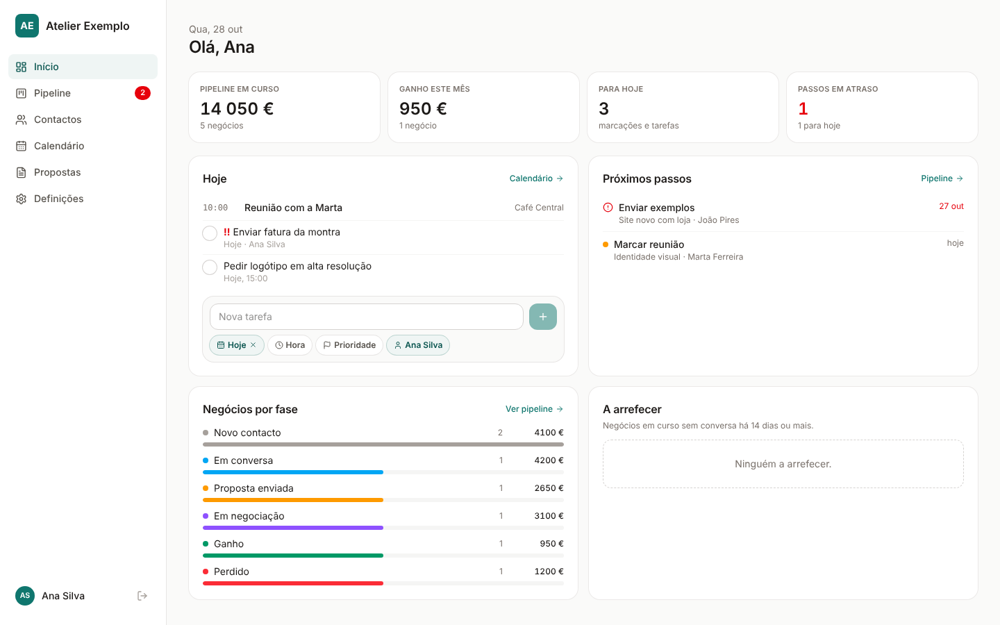
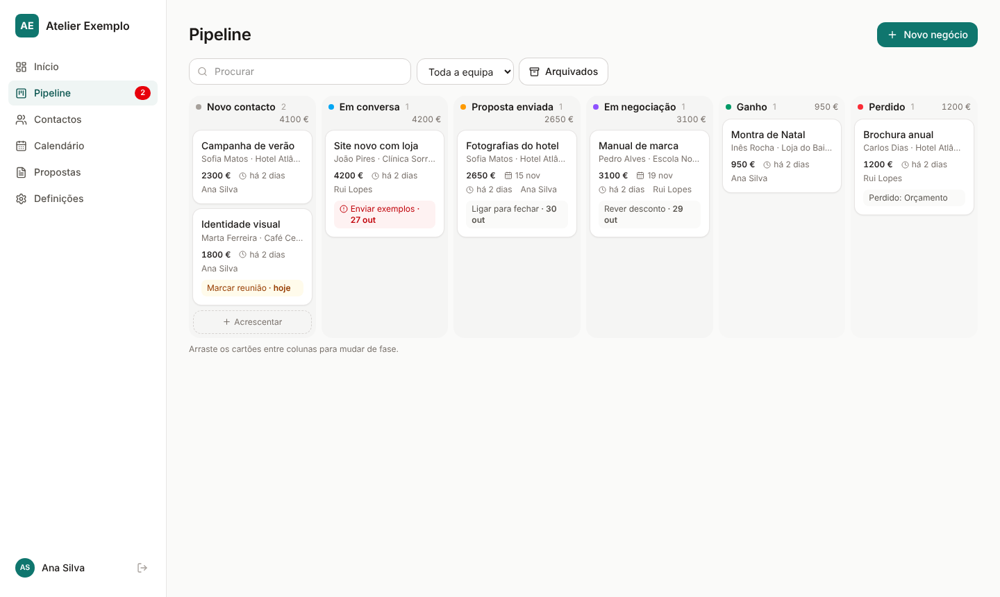
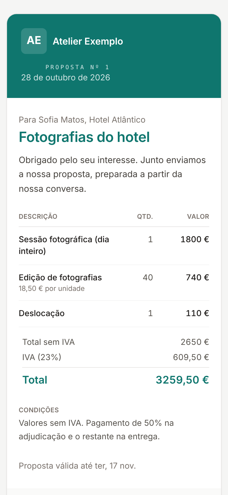

# Gestão para pequenos negócios

Uma app simples para gerir clientes, negócios, agenda e propostas de um pequeno negócio: serviços, eventos, agências, lojas, ateliers. Feita para o telemóvel e para o computador, em português de Portugal, com os dados guardados no Supabase e a app publicada como site estático (Cloudflare Workers, Netlify, Vercel ou outro).

Cada negócio põe o seu nome, logótipo, cor, moeda, IVA e fases do pipeline dentro da app, em Definições. Não é preciso mexer no código para começar.



| Pipeline no computador | Proposta que o cliente abre, no telemóvel |
| --- | --- |
|  |  |

## O que tem

* **Entrar** com Google ou com um link enviado por email (Supabase Auth). A primeira pessoa a entrar fica administradora.
* **Início**: valor do pipeline em curso, negócios por fase, o que há para hoje (agenda e tarefas), próximos passos em atraso e contactos a arrefecer.
* **Pipeline**: negócios por fase, arrastar entre colunas no computador e botões de fase no telemóvel. Cada negócio tem pessoa, empresa, valor, data prevista, próximo passo com data, notas e histórico (notas, chamadas, emails, reuniões, WhatsApp). Ao passar a uma fase de "perdido" a app pergunta o motivo.
* **Contactos e empresas**: pesquisa que ignora acentos e pontuação ("goncalves" encontra "Gonçalves"), categorias, ligar, WhatsApp e email num toque, aviso de possíveis repetidos e de emails inválidos.
* **Calendário**: vista do mês e agenda do dia, com marcações (reuniões, serviços, seguimentos) e tarefas com prazo, hora, prioridade e responsável.
* **Propostas**: editor com linhas (descrição, quantidade, preço), desconto, IVA e totais; página pública `/p/:token` onde o cliente vê a proposta e aceita (com o nome) ou recusa. A validade é verificada no servidor e, ao aceitar, o negócio passa a "ganho".
* **Definições**: perfil do negócio (nome, logótipo, cor, moeda, IVA, contactos), fases do pipeline, textos por omissão das propostas, equipa (administrador ou membro, ativo ou não) e o perfil de cada pessoa.

Tecnologia: React 19, Vite, Tailwind CSS 4, TypeScript, lucide-react, dnd-kit e supabase-js. Sem servidor próprio: a segurança está nas regras da base de dados (RLS).

## Instalar, passo a passo

Precisa de uma conta gratuita no [Supabase](https://supabase.com) e do Node.js 20 ou mais recente.

1. **Criar o projeto no Supabase.** Em supabase.com, crie um projeto novo (escolha a região mais perto, por exemplo Frankfurt ou Paris para Portugal) e guarde a password da base de dados.
2. **Criar as tabelas.** Abra o *SQL Editor*, cole o conteúdo de [`supabase/schema.sql`](supabase/schema.sql) e carregue em *Run*. Pode correr outra vez mais tarde (por exemplo depois de atualizar o modelo): não apaga dados.
3. **Expor o esquema `app`.** Em *Project Settings > Data API*, em *Exposed schemas*, acrescente `app` e guarde. Sem isto a app mostra "Não foi possível ler os dados".
4. **Entrar por email (link mágico).** Em *Authentication > Sign In / Providers*, confirme que *Email* está ligado. O link chega por email e não há passwords.
5. **Entrar com Google (opcional).** Na [Google Cloud Console](https://console.cloud.google.com/apis/credentials), crie um *OAuth client ID* do tipo *Web application* e, em *Authorized redirect URIs*, ponha `https://<o-seu-projeto>.supabase.co/auth/v1/callback`. Depois, no Supabase, em *Authentication > Sign In / Providers > Google*, ligue e cole o *Client ID* e o *Client secret*.
6. **Endereços autorizados.** Em *Authentication > URL Configuration*, ponha em *Site URL* o endereço final da app e acrescente em *Redirect URLs* `http://localhost:5173` (para testar no computador) e o endereço publicado (por exemplo `https://gestao.o-meu-negocio.pt`).
7. **Ligar a app ao projeto.** Copie `.env.example` para `.env` e preencha com os valores de *Project Settings > API*:
   ```
   VITE_SUPABASE_URL=https://<o-seu-projeto>.supabase.co
   VITE_SUPABASE_KEY=<a chave pública: anon ou publishable>
   ```
   Use só a chave pública. A chave `service_role` nunca vai para a app.
8. **Arrancar.**
   ```
   npm install
   npm run dev
   ```
   Abra http://localhost:5173 e entre. **A primeira pessoa a entrar fica administradora**, por isso entre logo a seguir a instalar. As outras pessoas são acrescentadas em Definições > Equipa, com o email com que vão entrar.

## Publicar

A app é um site estático (a pasta `dist` depois de `npm run build`). As variáveis do `.env` entram no momento da construção.

**Cloudflare Workers** (só ficheiros estáticos, sem código no servidor):
1. Mude o `name` em [`wrangler.jsonc`](wrangler.jsonc) se quiser.
2. `npx wrangler login` e depois `npm run deploy`.
3. A app fica em `https://<name>.<a-sua-conta>.workers.dev`. Para um domínio próprio, acrescente em *Workers > Settings > Domains*.

**Netlify**: comando de construção `npm run build`, pasta `dist`, as duas variáveis `VITE_...` em *Environment variables* e um ficheiro `public/_redirects` com a linha `/*  /index.html  200` para as rotas da app (como `/p/...`) abrirem direto.

**Vercel**: escolha Vite, ponha as duas variáveis e crie `vercel.json` com `{ "rewrites": [{ "source": "/(.*)", "destination": "/index.html" }] }`.

**Outro alojamento**: qualquer servidor que devolva `index.html` para os endereços que não são ficheiros (o chamado *SPA fallback*).

No fim, acrescente o endereço publicado em *Redirect URLs* no Supabase (passo 6).

## Adaptar ao seu negócio

**Sem código, em Definições** (só administradores):
* nome, logótipo (endereço de uma imagem), cor principal, moeda, IVA por omissão, email, telefone, site, NIF e morada; aparecem na app e nas propostas;
* fases do pipeline: nome, cor, tipo (em curso, ganho, perdido) e ordem;
* introdução, condições e validade das propostas novas;
* equipa: acrescentar pessoas, mudar o papel, desativar.

**No código**:
* [`src/config.ts`](src/config.ts): categorias de contacto, origens, dias até um contacto "arrefecer", nome e cor antes de entrar.
* [`src/index.css`](src/index.css): a cor principal é a variável `--marca`; os tons claros e escuros são calculados a partir dela com `color-mix`, por isso a app toda muda com uma só cor. Tipos de letra em `--font-sans`.
* [`src/lib/tipos.ts`](src/lib/tipos.ts): cores possíveis das fases, tipos de marcação na agenda e tipos de atividade.

## Segurança

* RLS ligado em todas as tabelas: só membros ativos (tabela `app.membros`) leem e escrevem; só administradores mudam a equipa e as definições.
* Visitantes sem conta só podem chamar `app.proposta_publica` e `app.proposta_responder`. A proposta abre por um código aleatório de 24 caracteres; rascunhos não aparecem; a validade, a resposta única e o nome obrigatório são verificados na base de dados.
* Nunca fica sem administrador: a base de dados recusa tirar ou despromover o último.
* A primeira pessoa a entrar com a equipa vazia fica administradora. Entre logo depois de instalar ou, se preferir, crie o primeiro administrador à mão no SQL Editor: `insert into app.membros (email, nome, papel) values ('o-seu@email.pt', 'O seu nome', 'admin');`
* A validade das propostas compara com a data do servidor do Supabase (UTC).

## Testes

* **Base de dados**: `tests/sql/correr.sh` cria um Postgres descartável, aplica o `schema.sql` duas vezes (tem de ser idempotente) e testa as regras: primeira pessoa admin, conta fora da equipa, membro, membro inativo e visitante sem conta com propostas válidas e fora de validade. Precisa dos programas do Postgres 15 ou mais recente (`initdb`, `pg_ctl`, `psql`).
* **App no browser**: `tests/historias.py` (Python com Playwright) simula a API do Supabase e percorre as histórias principais a 1440, 390 e 360 px de largura: entrar pela primeira vez, criar empresa e contacto, criar negócio, mudar de fase, perder com motivo, tarefa e marcação, proposta com "650,5" e IVA, aceitar pelo link público, mudar nome e cor. Verifica também que não há deslocamento horizontal nem erros na consola. Como correr está no início do ficheiro.

## Estrutura

```
supabase/schema.sql      tabelas, regras de segurança e funções públicas
src/config.ts            valores por omissão e listas simples
src/lib/                 ligação ao Supabase, dados, tipos, tema e formatação
src/components/          painéis, formulários, diálogos e o documento da proposta
src/pages/               Início, Pipeline, Contactos, Calendário, Propostas, Definições, Entrar e proposta pública
tests/                   testes da base de dados e do browser
wrangler.jsonc           publicação no Cloudflare Workers (só ficheiros estáticos)
```

## Ideias para módulos opcionais

* Caixa de email ligada aos contactos (IMAP ou Gmail), com o histórico de cada pessoa.
* Banco: importar extratos ou ligar por open banking e associar pagamentos a negócios.
* Assistente com IA para resumir o dia, escrever respostas e preencher fichas.
* Faturação através de um programa certificado (em Portugal a fatura tem de sair de software certificado).
* Exportar e importar contactos em CSV; anexos com o Supabase Storage.
* Subscrever o calendário no telemóvel (ICS) e um resumo diário por email.

## Licença

MIT. Ver [LICENSE](LICENSE).

## English

**Small business management app template.** A mobile friendly CRM for small businesses (services, events, agencies, shops), with the interface in European Portuguese: dashboard, deal pipeline with drag and drop, contacts and companies, calendar with tasks, and proposals with a public accept or decline page. Built with React 19, Vite, Tailwind CSS 4, TypeScript and Supabase (Postgres with row level security; no custom backend).

Setup in short: create a Supabase project, run `supabase/schema.sql` in the SQL Editor, add `app` to *Exposed schemas* in the Data API settings, enable email (magic link) and optionally Google sign in, add your local and production URLs to the auth redirect list, copy `.env.example` to `.env` with your project URL and public key, then `npm install` and `npm run dev`. The first person to sign in becomes the administrator. Business name, logo, colour, currency, VAT rate, pipeline stages and proposal texts are edited in the app under *Definições*. Deploy the `dist` folder to Cloudflare Workers (`npm run deploy`), Netlify, Vercel or any static host with a single page app fallback. Licensed under MIT.
